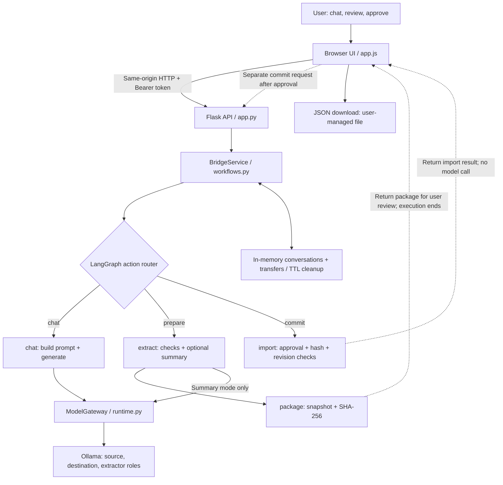

# Cross-Assistant Context Bridge

A local proof of concept for moving conversation context between two assistant roles through a reviewable, explicitly approved handoff.

The source and destination run inside this application using configurable Ollama models. This is not a connector to existing Gemini, Claude, or other hosted chat histories.

## Project status

This documentation describes the uploaded `workflows.py`, `runtime.py`, `app.py`, and `app.js` snapshots. It documents implementation, not a claim that all paths have been executed or tested. The screenshots and uploaded code may represent different revisions; check the integration notes below before a demo.

## What it does

- Provides separate source and destination chat conversations.
- Prepares raw-message or structured-summary handoffs.
- Displays the prepared package before import.
- Requires explicit approval tied to the package hash.
- Checks destination revision and model identity before import.
- Keeps import separate from destination model continuation.
- Exports the package as JSON.
- Retains application records temporarily in process memory.

Message-level selection appears in the supplied UI screenshot, but the uploaded service prepares a full source snapshot and does not accept selected message IDs. Do not claim end-to-end selective exclusion until the UI/API/backend path is verified.

## Architecture



The separate architecture image gives a presentation-friendly component and workflow view. The Mermaid source is supplied for editing.

### Responsibilities

| Component | Responsibility |
|---|---|
| Browser UI | Chat panels, package preview, approval action, activity log, JSON export |
| Flask API | HTTP endpoints, local host/origin checks, Bearer token check, request size limit |
| BridgeService | Workflow functions, validation, conversation and transfer records |
| LangGraph | Routes actions and passes intermediate state between nodes |
| Pydantic | Validates imported messages and structured extraction output |
| ModelGateway / OllamaProvider | Configures model roles and performs inference requests |
| In-memory dictionaries | Temporary conversations and prepared transfers |

### LangGraph execution

```text
chat:       START -> chat -> END
prepare:    START -> extract -> package -> END
commit:     START -> import -> END
continue:   calls the ordinary chat route after checking a handoff exists
```

Each operation invokes the compiled graph separately. Approval happens between preparation and commit requests, not through a paused LangGraph execution. No checkpointer, durable execution, autonomous tool selection, or graph-level retry cycle is configured.

## Transfer modes

### Raw messages (`messages`)

The extract node performs preparation checks, then returns without invoking the extractor model. The package contains the source snapshot's user and assistant messages. Raw mode preserves wording but may include irrelevant or superseded context and can exceed the destination context budget.

### Structured summary (`summary`)

The extractor receives source user messages and produces these categories:

- `project_goal`
- `requirements`
- `constraints`
- `decisions`
- `rejected_options`
- `current_progress`
- `open_questions`
- `next_task`

Each fact contains `text` and `evidence_ids`. Pydantic validates the schema; explicit checks reject empty summaries, truncated output, and unknown evidence IDs. Validation failures allow up to two extraction attempts inside a Python loop. After repeated validation failure, the service returns an error suggesting raw mode; it does not automatically switch modes. Network failures are not covered by that validation retry loop.

Valid evidence IDs do not prove semantic correctness. Corrections, rejected options, completeness, and duplication still require review and evaluation.

## Suggested project layout

The following layout reflects paths referenced by the code; ensure all referenced assets are present in your working repository.

```text
project/
  app.py
  runtime.py
  workflows.py
  .env                         # local configuration; do not commit
  templates/
    index.html
  static/
    app.js
    ...                        # styles/assets referenced by the template
  prompts/
    chat_system.txt
    continue_project.txt
    extract_request.txt
    extract_retry.txt
    extract_system.txt
    handoff_reference.txt
```

## Local setup

These are inferred setup instructions from the imports and defaults, not a verified reproducible build. Dependency versions were not supplied. Use the project's lockfile if one exists; otherwise install compatible versions and record the versions you validate.

Prerequisites: a Python environment supporting the supplied type syntax (Python 3.10+), Ollama installed locally, the configured models, and sufficient RAM for your model/context settings.

### 1. Create an environment and install dependencies

```bash
python -m venv .venv
# macOS / Linux
source .venv/bin/activate
# Windows PowerShell alternative:
# .venv\Scripts\Activate.ps1

python -m pip install flask langgraph "pydantic>=2,<3" requests python-dotenv
```

### 2. Prepare local models

With Ollama installed, ensure its service is running. If it is not already running, start it in a separate terminal:

```bash
ollama serve
```

Pull the models used by the code defaults:

```bash
ollama pull llama3.2:latest
ollama pull llama3.2:1b
```

Model downloads and package installation require connectivity. Inference uses the configured endpoint, which defaults to localhost. Do not assume a configuration pointing to a remote endpoint keeps data local.

### 3. Configure `.env`

Generate a random token:

```bash
python -c "import secrets; print(secrets.token_urlsafe(32))"
```

Create `.env` beside `runtime.py`, replacing the token value with that output:

```dotenv
BRIDGE_API_TOKEN=<paste-generated-token>
PORT=5000
OLLAMA_URL=http://127.0.0.1:11434
SOURCE_PROVIDER=ollama
DESTINATION_PROVIDER=ollama
EXTRACTOR_PROVIDER=ollama
SOURCE_MODEL=llama3.2:latest
DESTINATION_MODEL=llama3.2:1b
EXTRACTOR_MODEL=llama3.2:latest
CONTEXT_WINDOW=4096
MODEL_TIMEOUT=300
CHAT_OUTPUT_TOKENS=300
EXTRACT_OUTPUT_TOKENS=1400
KEEP_ALIVE=0
```

The API requires a token of at least 24 characters and rejects its known example placeholder. Only the `ollama` provider is implemented. Source, destination, and extractor are configurable roles, not necessarily three distinct loaded models. Output budgets must be positive and smaller than `CONTEXT_WINDOW`.

Add `.env`, `.venv/`, caches, and any private exported context to your local `.gitignore`.

### 4. Start the application

```bash
python app.py
```

Open `http://127.0.0.1:5000` when using the default port. The server binds to loopback and runs with debug disabled. Resolve the integration issues below if your local snapshot fails to start or a route returns 404.

## Demo walkthrough

Use synthetic, non-sensitive conversation data only.

1. Start an independent source and destination conversation.
2. Describe a project in the source panel, including constraints and an undecided choice.
3. Add a correction, such as replacing React with plain HTML and JavaScript.
4. Choose raw or summary mode and prepare the handoff.
5. Review the package, destination, and source snapshot revision.
6. Approve the import. Preparation alone does not modify the destination.
7. Observe the separately requested destination continuation.
8. Ask the destination to restate current decisions and open questions.
9. Optionally download the JSON package.

A newer source message does not automatically update a prepared snapshot. Prepare again to include it. A destination revision change blocks import and requires a fresh handoff.

## API contract

All API requests require `Authorization: Bearer <token>`. JSON writes use `Content-Type: application/json`.

The parameterized paths below express the intended frontend/service contract. Verify Flask route converters in your actual source; the extracted upload does not reliably preserve them.

| Method | Intended path | Purpose |
|---|---|---|
| GET | `/api/v1/health` | Health metadata; does not prove model availability |
| GET | `/api/v1/config` | Model configuration |
| POST | `/api/v1/conversations` | Create a role-backed or imported conversation |
| GET | `/api/v1/conversations/{id}` | Read a conversation |
| POST | `/api/v1/conversations/{id}/messages` | Generate a reply |
| POST | `/api/v1/conversations/{id}/continue` | Continue after handoff import |
| POST | `/api/v1/transfers/prepare` | Create a reviewable transfer |
| GET | `/api/v1/transfers/{id}` | Read a prepared transfer |
| POST | `/api/v1/transfers/{id}/commit` | Approve and import |

Prepare body:

```json
{"source_id":"SOURCE_ID","destination_id":"DESTINATION_ID","mode":"summary"}
```

Commit body (use the hash returned by preparation):

```json
{"approved":true,"payload_sha256":"HASH_FROM_PREPARE_RESPONSE"}
```

The frontend also calls `POST /api/v1/sessions/clear`. A service deletion method exists, but the corresponding route is not visible in the supplied `app.py` extract. Verify or implement that endpoint before relying on the Clear session button.

## Approval and integrity

The prepared transfer includes a canonical JSON SHA-256 digest. Commit requires explicit approval, a matching supplied hash, an intact stored package, and an unchanged destination model/revision. Repeated commit of an existing imported transfer returns `already_imported` while that record remains available.

The digest is not encryption, a digital signature, or proof of source authenticity. Packages set `origin_verified` to `false`. Exported JSON is plaintext, and export does not require the destination import approval step.

## Data lifecycle and security boundary

- Conversations and transfers are held in service dictionaries, not a database.
- Conversation TTL is 1,800 seconds, refreshed on conversation reads.
- Prepared-transfer TTL is 300 seconds.
- Cleanup is triggered by service operations rather than a scheduled background job.
- Restarting the process loses application records.
- Browser localStorage retains conversation IDs, not full conversation content; the page still holds displayed content while open.
- Host and Origin checks, API Bearer checks, response security headers, and a 1 MiB request limit are present.
- The page receives the API token to make same-origin calls. This is a single-user local prototype, not a multi-user authentication boundary.
- A process-local lock serializes relevant operations; this is not distributed concurrency control.
- Application cleanup does not guarantee deletion of exported files, browser artifacts, or model-runtime state.
- Imported text is rendered into the destination prompt. No dedicated adversarial prompt-injection evaluation is demonstrated.

## Limits and known integration issues

1. The health response reports `persistence="sqlite"`, but the uploaded service is memory-only. Correct the metadata.
2. The supplied code extraction loses indentation and some route details, and includes abbreviated portions. Verify the actual Python source before running it; do not reconstruct runnable source from the extracted text alone.
3. Message-selection UI must be wired to server-side allowlisted message IDs before selective transfer is claimed.
4. Verify the Clear session route and all template/static assets.
5. No direct hosted-chat integration, MCP server, browser extension, or external JSON importer is demonstrated.
6. Structured validation is not semantic verification. The exported examples show repeated facts across summary categories.
7. Context size is estimated heuristically; messages are not automatically chunked or truncated to fit.
8. Destination continuation may fail after successful import. The UI distinguishes these outcomes; retry destination chat rather than assuming import failed.
9. There is no demonstrated automated test suite, production deployment, end-to-end encryption, durable workflow recovery, or multi-user isolation.

## Suggested validation checklist (not claimed as executed)

- Raw package matches the intended source scope.
- Summary facts reference existing user-message IDs.
- Current decisions override superseded choices without inventing database decisions.
- Missing approval and incorrect hashes are rejected.
- Destination changes block stale imports.
- Repeated commits do not duplicate imports or automatic continuation.
- Expired records return errors and restart clears application memory.
- Model failures and truncation are visible to the user.
- Selective exclusion is enforced in the backend once implemented.
- Source text containing malicious instructions does not override destination policy.

## Possible extensions

Server-enforced message selection; semantic correction tests; separate extraction/validation graph nodes; durable approval resumption; supported platform connectors or MCP; user-mediated import for unsupported destinations; and recipient-bound encrypted export.

These are future options, not implemented capabilities.
